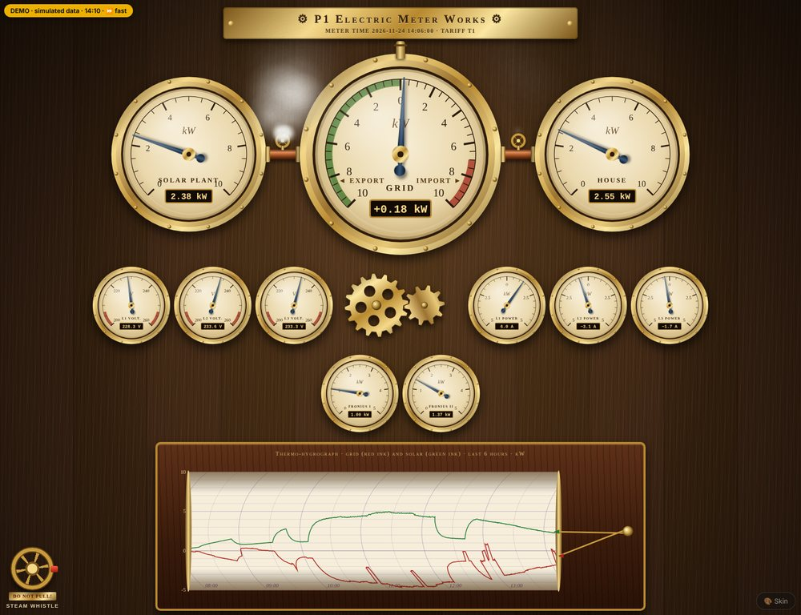
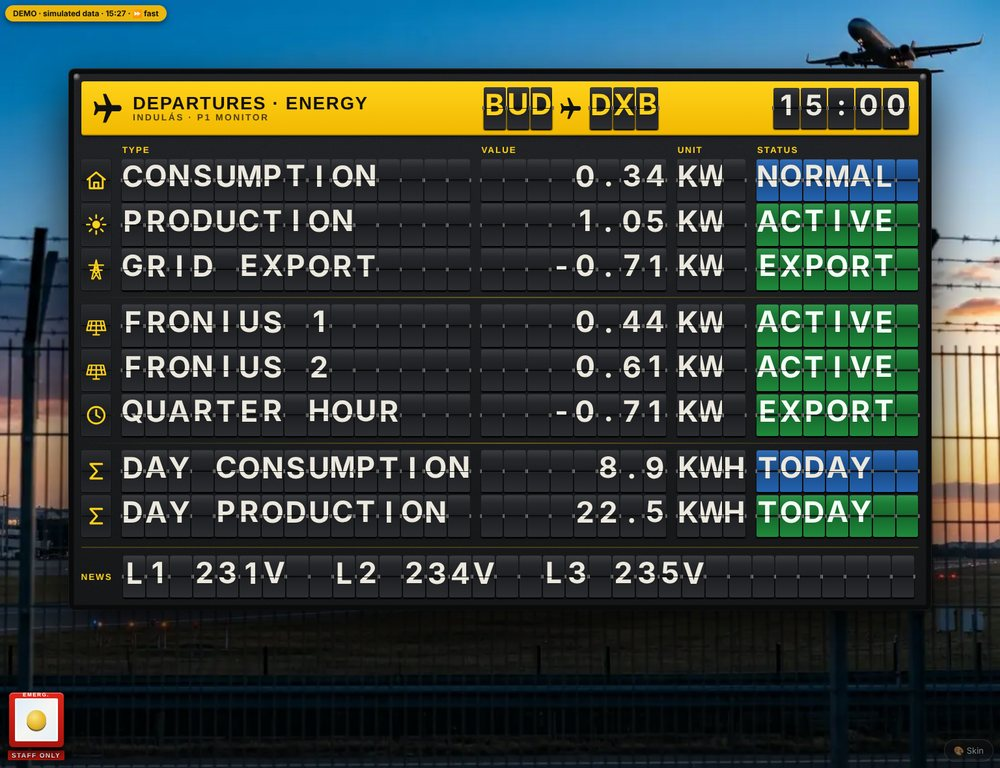
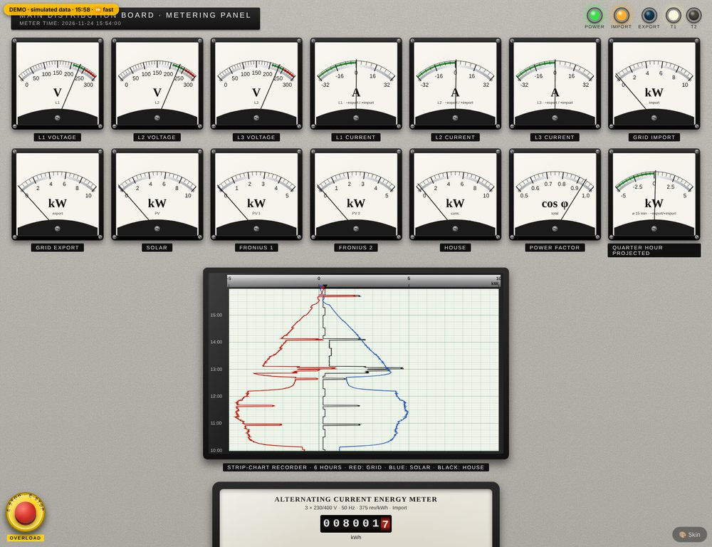
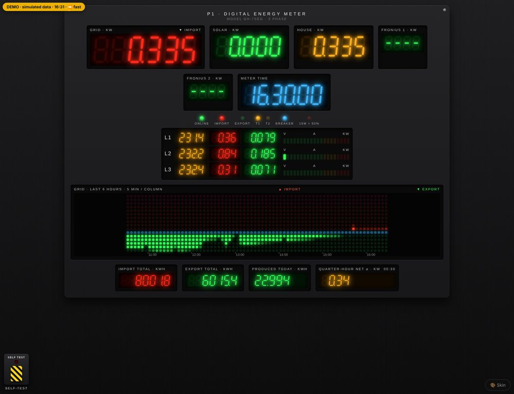
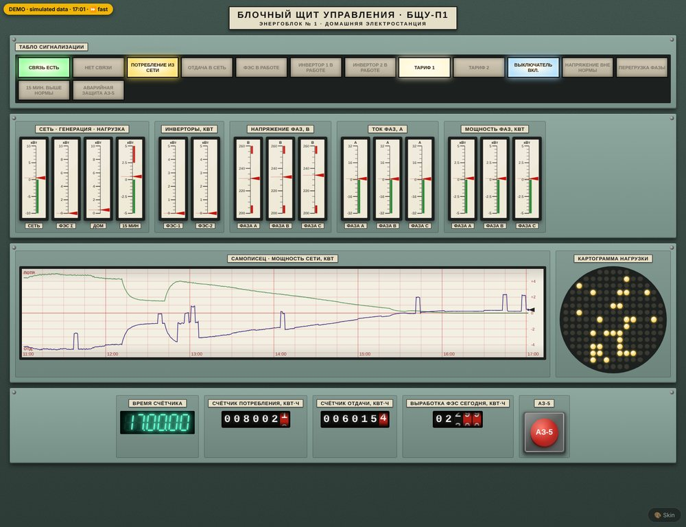
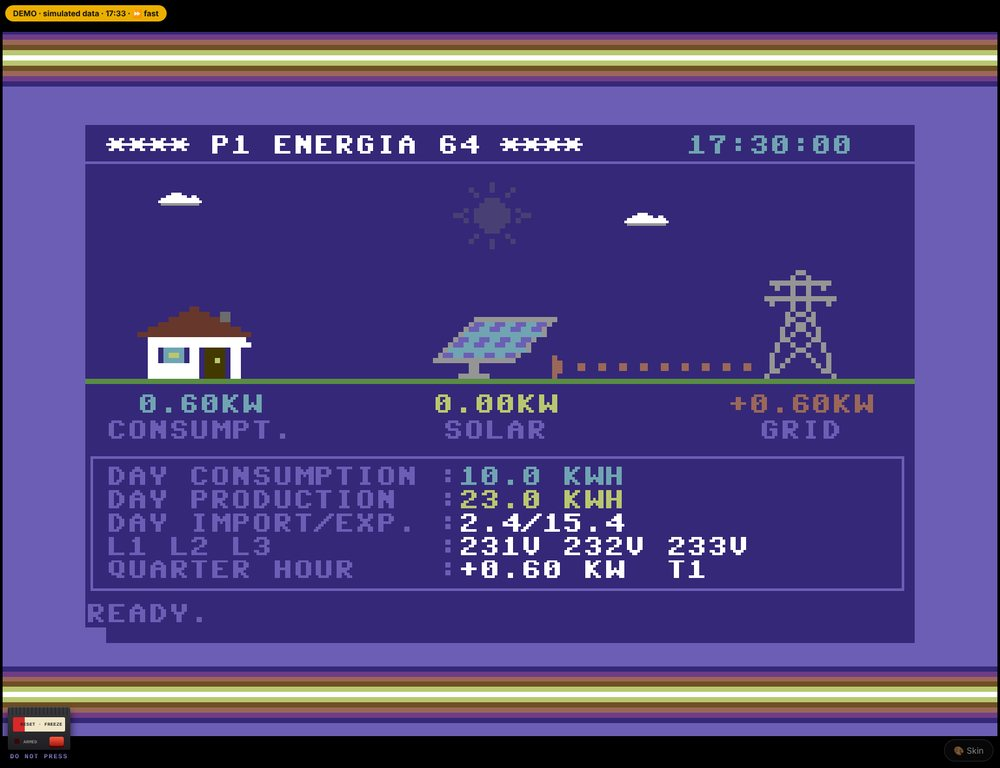

# P1 Monitor

[English](README.md) · **Magyar**


Helyi, élő webes kijelző okos villanyórához, amelyet egy **GreenHESS ADA P1
Meter** olvas ki, opcionálisan **Fronius** inverterekkel (Solar API v1).
Egy kis Python szerver (csak beépített modulokkal) és egy önálló HTML oldal
kilenc kézzel készített kinézettel (skinnel): nixie csövek, steampunk, reptéri
lapozós tábla, analóg kapcsolószekrény, LED panel, csernobili vezérlőpult,
Commodore 64, modern és mátrix — szintetizált hangeffektekkel és minden skinen
egy „ne nyúlj hozzá” gombbal.

**▶ [Élő demó](https://gali-master.github.io/P1-Monitor/)** (szimulált adatok, a böngésződben fut) · **⬇ [Letöltés](https://github.com/gali-master/P1-Monitor/releases/latest)** · **❤ [Támogatás](https://github.com/sponsors/gali-master)**

## Tudnivalók

- Élő hálózati vétel/betáplálás, házfogyasztás, napelemes termelés
  (inverterenként), fázisonkénti feszültség / áram / teljesítmény, negyedórás
  átlag, tarifa, mérőállások
- Napi összesítők (fogyasztás, termelés, vétel, betáp)
- 6 óra előzmény a RAM-ban (grafikonok, szalagíró, barográf)
- Minden a saját hálózatodon marad: nincs felhő, nincs CDN, nincs külső kérés
- A P1 olvasó felhős **felhasználónevét, jelszavát és a mérő azonosítóit
  azonnal eldobja** — sehol nem tárolja, nem naplózza, nem adja tovább
- Kíméli a Raspberry Pi SD kártyáját: előzmény a RAM-ban, naponta egyetlen kis
  fájlírás
- Hangmotor: minden hang a böngészőben készül (nincsenek hangfájlok)
- Demó mód beépített szimulátorral — hardver nélkül is kipróbálható
- Angol és magyar felület (angolul indul)

## Skinek

| | | |
|---|---|---|
|  Steampunk |  Reptéri tábla |  Analóg kapcsolószekrény |
|  LED panel |  Vezérlőpult |  Commodore 64 |

## Először próbáld ki (demó mód)

Töltsd le a `p1monitor.html` fájlt, és nyisd meg közvetlenül a böngészőben
(dupla kattintás). Szerver nélkül demó módban fut, szimulált adatokkal.

Címbe írható opciók (a szerveren is működnek):

| Opció | Jelentés |
|---|---|
| `?demo` | demó mód kényszerítése |
| `?at=13` | a demó 13:00-kor indul (napos dél) |
| `?lang=hu` / `?lang=en` | a felület nyelve (a böngésző megjegyzi) |
| `?skin=nixie` | adott skin megnyitása (`nixie`, `steampunk`, `solari`, `analog`, `led`, `chernobyl`, `c64`, `modern`, `matrix`) |

## Mi kell hozzá

- **GreenHESS ADA P1 Meter**, a mérő P1 portjára és a Wi-Fi-re csatlakoztatva,
  a helyi JSON felülete elérhető a hálózaton
- Opcionálisan **Fronius** inverter(ek), bekapcsolt *Solar API*-val
  (inverter webes felülete → Beállítások → „Solar API” / „Solar API v1”
  engedélyezése)
- Egy folyamatosan működő gép ugyanazon a hálózaton — pl. **Raspberry Pi** —
  **Python 3.8 vagy újabb** verzióval (más csomag nem kell)
- Bármilyen mai böngésző (gép vagy telefon) a megjelenítéshez

## Telepítés

### 1. Címek kiderítése

- **A P1 olvasó és az inverterek IP címe:** a routered csatlakozott eszközök
  listájában (DHCP kliensek) találod. Érdemes mindegyiknek fix (foglalt) IP-t
  adni a routerben.
- **A P1 olvasó JSON felületének portja:** az eszköz leírásában vagy
  beállításaiban, illetve porttal pásztázva: `nmap -p 1-65535 <P1-IP>`
- **Próba** böngészőben vagy: `curl http://<P1-IP>:<PORT>/json`

> ⚠️ **Figyelem:** a P1 olvasó nyers `/json` válasza tartalmazza a felhős
> fiókod felhasználónevét és jelszavát, valamint a mérő azonosítóit. Ne
> másold be sehova nyilvánosan. A P1 Monitor ezeket a mezőket azonnal
> eldobja. Az eszköz `/restart` és `/factoryreset` címét soha ne nyisd meg.

- **Fronius próba:** a `http://<INVERTER-IP>/solar_api/v1/GetPowerFlowRealtimeData.fcgi`
  címnek JSON-t kell adnia.

### 2. Letöltés

```bash
git clone https://github.com/gali-master/P1-Monitor.git
sudo mv P1-Monitor /opt/p1monitor      # vagy bárhol tarthatod
cd /opt/p1monitor
```

(Vagy töltsd le a ZIP-et a [legfrissebb kiadásból](https://github.com/gali-master/P1-Monitor/releases/latest), és csomagold ki.)

### 3. Beállítás

```bash
cp config.example.json config.json
nano config.json
```

| Kulcs | Jelentés |
|---|---|
| `p1_url` | a P1 olvasó JSON címe: `http://<P1-IP>:<PORT>/json` |
| `inverters` | Fronius inverterek listája `{"name": "...", "host": "<IP>"}` — ha nincs, legyen `[]`. Az oldal legfeljebb 2-t mutat külön, összegezve mindet. |
| `listen.port` | a weboldal portja (alapból `8080`) |
| `listen.host` | `0.0.0.0` = a hálózatról elérhető, `127.0.0.1` = csak erről a gépről |
| `poll_s` | lekérdezési gyakoriság másodpercben (alapból 5) |
| `history_h` | ennyi óra előzmény marad a RAM-ban (alapból 6) |
| `stale_s` / `inv_stale_s` | ennyi másodperc után számít hiányzónak az adat |
| `state_file` | napi pillanatkép fájl (naponta egyszer íródik) |
| `ui.LANG` | a felület alapnyelve: `"en"` vagy `"hu"` (a menü nyelvgombja böngészőnként felülírja) |
| `ui.SP_TITLE` | a steampunk skin felirata |
| `ui.GRID_MAX`, `PV_MAX`, `INV_MAX`, `HOME_MAX`, `PHASE_KW`, `A_MAX`, `QH_MAX`, `REC_KW` | a műszerek végkitérése (kW / A) — állítsd a saját rendszeredhez |
| `ui.WHISTLE_KW` | steampunk: e feletti vételnél fújtat a gőzsíp (kW) |
| `ui.FERRARIS_REV` | analóg: a Ferraris-tárcsa fordulata kWh-nként |

A szerver nem indul el, amíg a példa helykitöltő címei benne vannak a
`config.json`-ban.

### 4. Indítás

```bash
python3 p1monitor.py
```

Nyisd meg böngészőben: `http://<SZERVER-IP>:8080/` (a saját `listen.port`
értékeddel). Leállítás: `Ctrl+C`.

### 5. Automatikus indulás (systemd, opcionális)

Írd át a `p1monitor.service` fájlban a `YOUR_USER` részt arra a Linux
felhasználóra, aki futtatja, és a `/opt/p1monitor` utat a saját mappádra.
Utána:

```bash
sudo cp p1monitor.service /etc/systemd/system/
sudo systemctl daemon-reload
sudo systemctl enable --now p1monitor
systemctl status p1monitor          # "active (running)" kell legyen
journalctl -u p1monitor -n 30       # napló, ha valami nem jó
```

A szolgáltatás alacsony prioritással fut, legfeljebb 25% CPU-t és 100 MB
RAM-ot használhat.

### Frissítés

Cseréld le a `p1monitor.html` és/vagy `p1monitor.py` fájlt az újra (a
`config.json` marad). `.py` csere után: `sudo systemctl restart p1monitor`.
HTML csere után elég az oldalt frissíteni.

## Használat

- **Skin menü:** bal felül. Az utolsó választást a böngésző megjegyzi.
- **Nyelv:** a felület angol és magyar; a menü 🌐 gombjával váltható. Alapból angolul indul.
- **Teljes képernyő:** dupla kattintás / dupla koppintás.
- **Hang:** a menü hanggombja váltogat: *ki → halk → normál*. A böngészők
  csak az első kattintás vagy érintés után engednek hangot.
- **„Ne nyúlj hozzá” gomb** (bal alul, minden skinen más): az első kattintás
  felnyitja a fedelet, a második elsüti a meglepetést.

## API

| Cím | Tartalom |
|---|---|
| `/api/now` | legfrissebb adat (JSON), `ok` = friss az adat |
| `/api/history?n=720` | a RAM-ban tartott előzmény, legfeljebb `n` pont |

## Adatvédelem, biztonság

- Semmi nem hagyja el a hálózatodat; az oldal nem tölt be külső erőforrást.
- Az oldalnak **nincs jelszava**: tartsd az otthoni hálózaton, ne nyiss rá
  portot az internet felé.
- Az előzmény csak a RAM-ban van; a `p1state.json` csak az éjféli mérőállást
  tárolja (a napi összesítőkhöz).

## Hibakeresés

| Jelenség | Mit nézz meg |
|---|---|
| „nincs friss adat” | jó-e a `p1_url`? Nyisd meg böngészőben. Online-e a P1 olvasó? |
| éjjel az inverter nem válaszol | normális — fény nélkül a Fronius alszik |
| a napi értékek részlegesek | a program napközben indult; éjféltől pontosak |
| `Address already in use` | a `listen.port`-ot más program használja — válassz másikat |
| nincs hang | kattints egyet az oldalon; nézd meg a hanggombot és a hangerőt |


## A projekt támogatása

Ha hasznos neked a P1 Monitor, a fejlesztését a
[GitHub Sponsors](https://github.com/sponsors/gali-master) oldalon támogathatod — vagy az
oldal tetején lévő ❤ **Sponsor** gombbal. Köszönöm!

## Licenc

MIT — lásd [LICENSE](LICENSE).

A GreenHESS, ADA, Fronius és Commodore nevek a tulajdonosaik védjegyei. Ez a
projekt nem áll kapcsolatban velük, és nem általuk támogatott.
