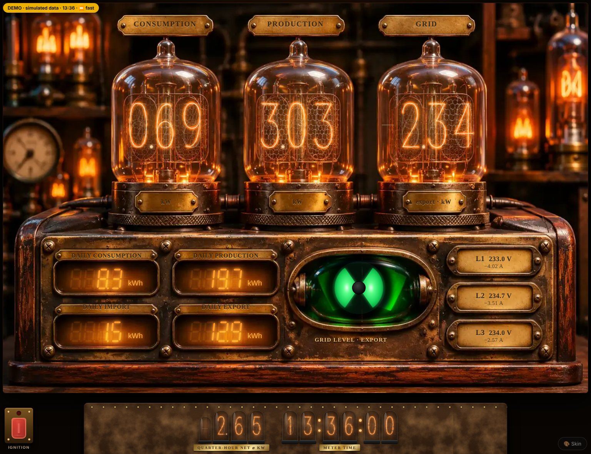
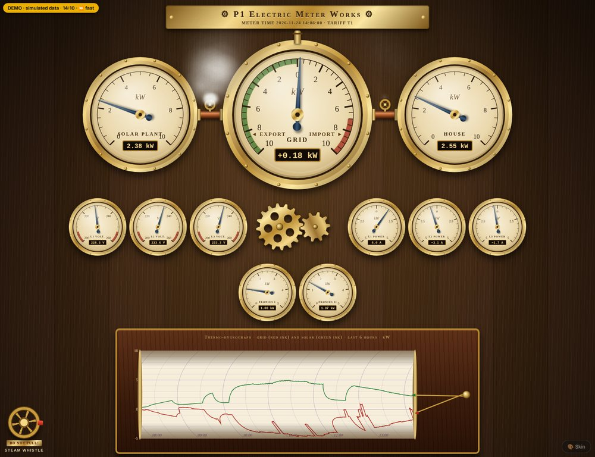
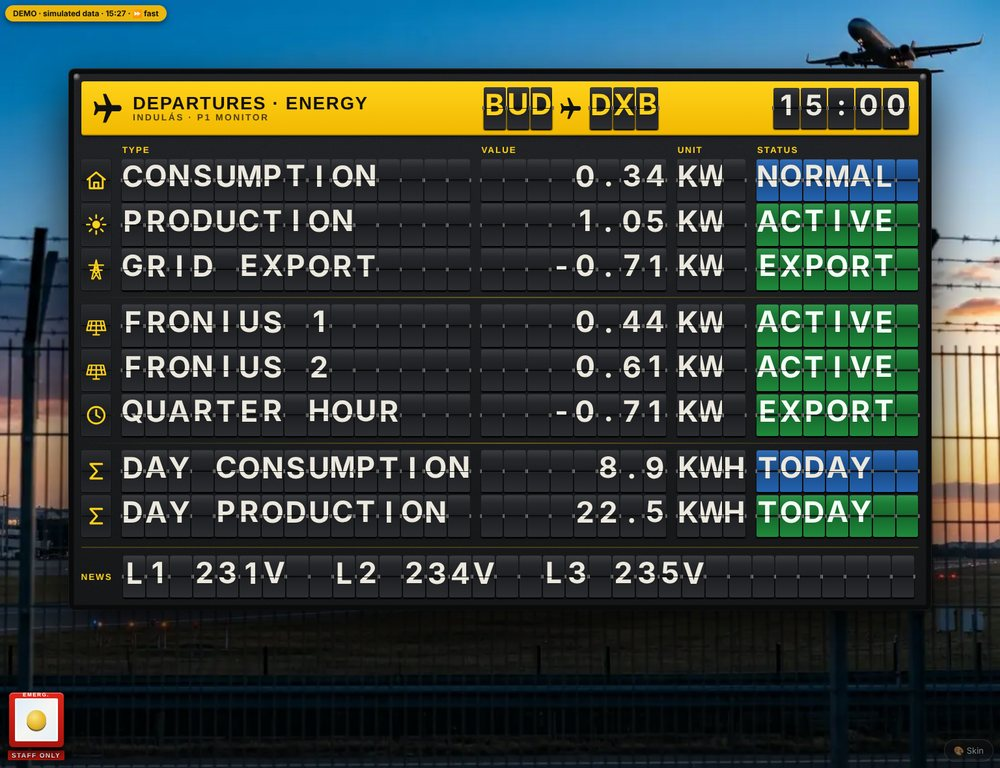
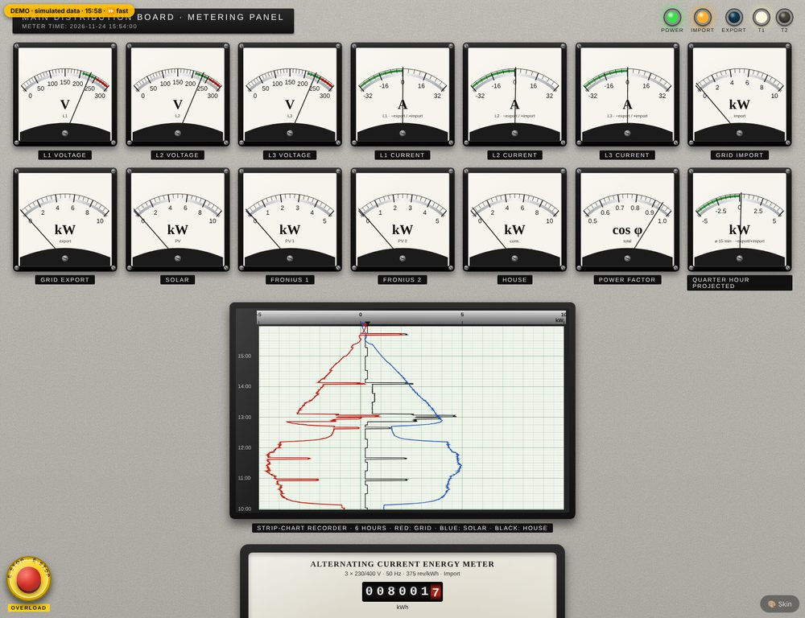
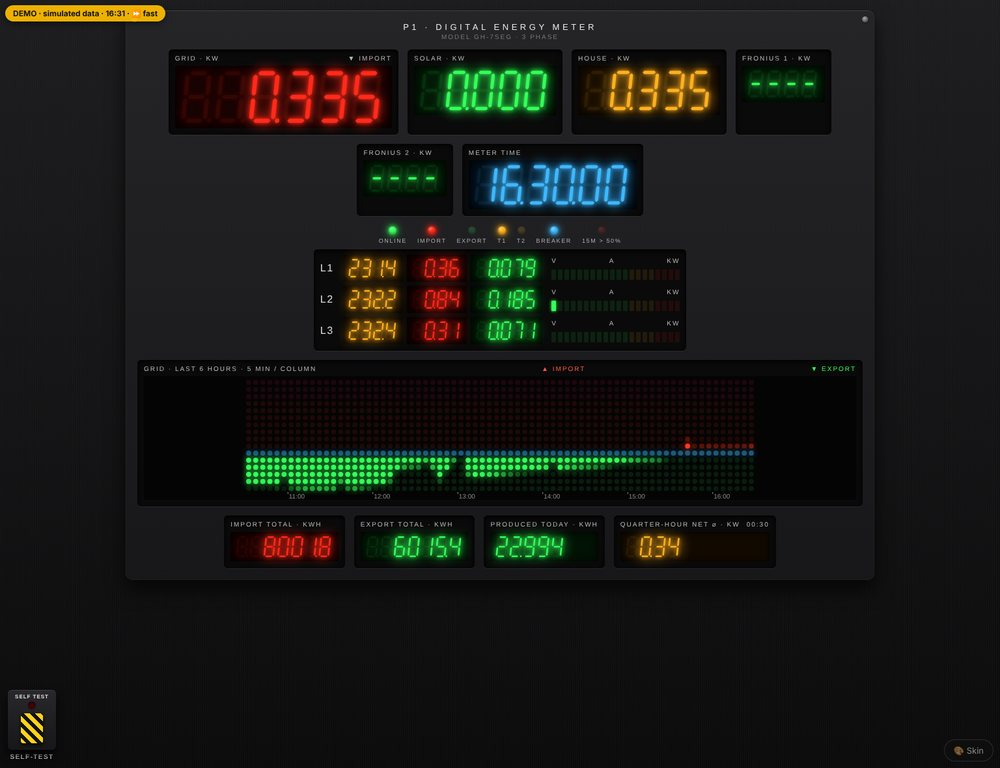
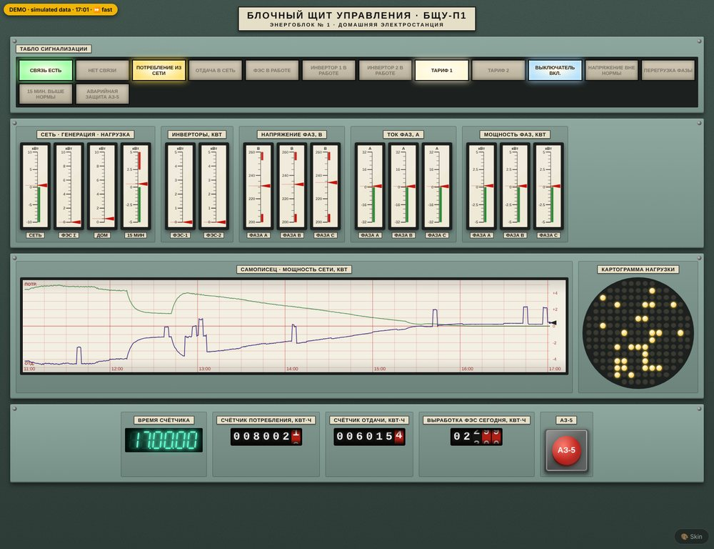
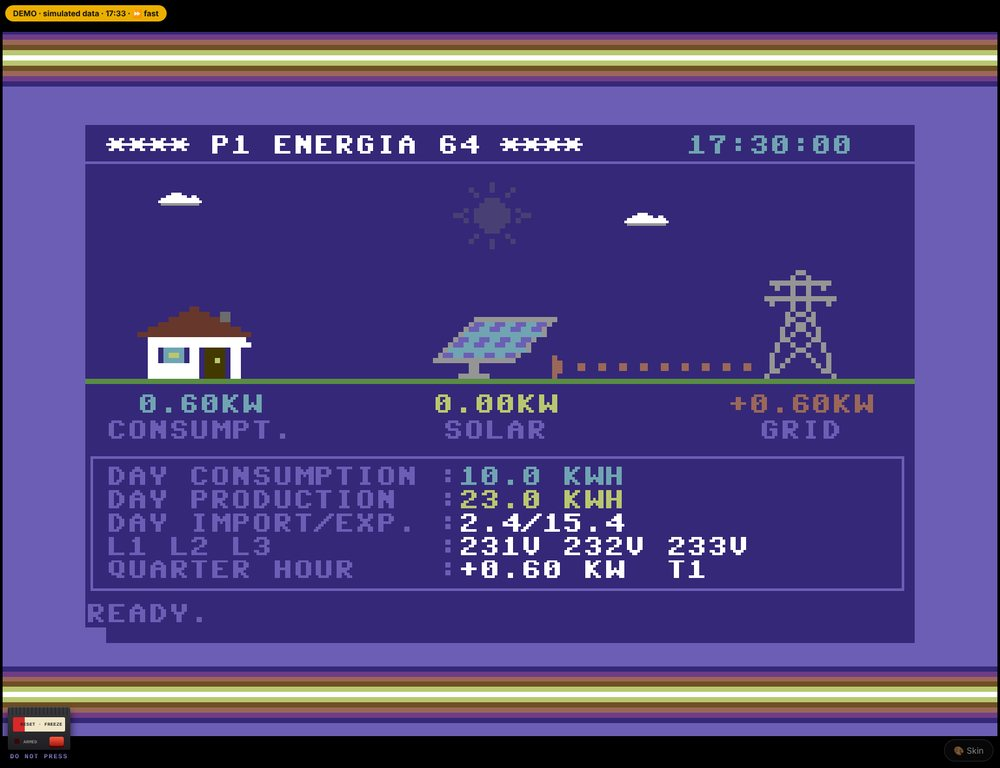

# P1 Monitor

**English** · [Magyar](README.hu.md)



A local, live web display for smart electricity meters. It reads the local
JSON interface of a P1 reader (developed and tested with the GreenHESS ADA P1
Meter) and, optionally, Fronius inverters through their Solar API v1.
*An independent, unofficial hobby project — see the [notice](#license) below.*
One small Python server (standard library only) and one self-contained HTML page
with seven hand-made skins: nixie tubes, steampunk, airport split-flap board,
analog switchboard, LED panel, Chernobyl-style control desk and Commodore 64 —
with synthesized sound effects and a "do not touch" button on every skin.

**▶ [Live demo](https://gali-master.github.io/P1-Monitor/)** (simulated data, runs in your browser) · **⬇ [Download](https://github.com/gali-master/P1-Monitor/releases/latest)** · **❤ [Sponsor](https://github.com/sponsors/gali-master)**

## Features

- Live grid import/export, house consumption, PV production (per inverter),
  per-phase voltage / current / power, quarter-hour average, tariff, meter totals
- Daily totals (consumption, production, import, export)
- 6 hours of history in RAM (graphs, plotter, barograph)
- Everything stays on your network: no cloud, no CDN, no external requests
- The P1 reader's cloud **username, password and meter identifiers are dropped
  immediately** — never stored, logged or served
- Gentle on a Raspberry Pi SD card: history in RAM, one small file write per day
- Sound engine: everything is synthesized in the browser (no sound files)
- Demo mode with a built-in simulator — try it without any hardware
- English and Hungarian interface (starts in English)

## Skins

| | | |
|---|---|---|
|  Steampunk |  Airport board |  Analog switchboard |
|  LED panel |  Control desk |  Commodore 64 |

## Try it first (demo mode)

Download `p1monitor.html` and open it directly in a browser (double-click).
Without a server it runs in demo mode with simulated data.

URL options (also work on the server):

| Option | Meaning |
|---|---|
| `?demo` | force demo mode |
| `?at=13` | demo starts at 13:00 (sunny midday) |
| `?lang=hu` / `?lang=en` | interface language (remembered by the browser) |
| `?skin=nixie` | open a given skin (`nixie`, `steampunk`, `solari`, `analog`, `led`, `chernobyl`, `c64`) |

## Requirements

- A P1 reader with a local JSON interface — developed and tested with the
  GreenHESS ADA P1 Meter — connected to the meter's P1 port and to your
  Wi-Fi, with its local JSON API reachable on your network
- Optional: **Fronius** inverter(s) with *Solar API* enabled
  (inverter web interface → Settings → enable "Solar API" / "Solar API v1")
- An always-on computer on the same network — e.g. a **Raspberry Pi** — with
  **Python 3.8 or newer** (no extra packages needed)
- Any modern browser (desktop or phone) for viewing

## Installation

### 1. Find the addresses

- **IP address of the P1 reader and the inverters:** look them up in your
  router's list of connected devices (DHCP clients). A fixed (reserved) IP for
  each device is recommended.
- **Port of the P1 reader's JSON API:** see the device's documentation or
  settings, or scan the device: `nmap -p 1-65535 <P1-IP>`
- **Test it** in a browser or with `curl http://<P1-IP>:<PORT>/json`

> ⚠️ **Warning:** the raw `/json` answer of the P1 reader contains the
> username and password of your cloud account and your meter's identifiers.
> Do not paste it anywhere public. P1 Monitor removes these fields
> immediately. Never open the device's `/restart` or `/factoryreset`
> addresses.

- **Fronius test:** `http://<INVERTER-IP>/solar_api/v1/GetPowerFlowRealtimeData.fcgi`
  should return JSON.

### 2. Download

```bash
git clone https://github.com/gali-master/P1-Monitor.git
sudo mv P1-Monitor /opt/p1monitor      # or keep it anywhere you like
cd /opt/p1monitor
```

(Or download the ZIP from the [latest release](https://github.com/gali-master/P1-Monitor/releases/latest) and unpack it.)

### 3. Configure

```bash
cp config.example.json config.json
nano config.json
```

| Key | Meaning |
|---|---|
| `p1_url` | JSON address of the P1 reader: `http://<P1-IP>:<PORT>/json` |
| `inverters` | list of Fronius inverters `{"name": "...", "host": "<IP>"}` — use `[]` if you have none. The page shows up to 2 individually; all are added up. |
| `listen.port` | port of the web page (default `8080`) |
| `listen.host` | `0.0.0.0` = reachable from the network, `127.0.0.1` = this machine only |
| `poll_s` | polling interval in seconds (default 5) |
| `history_h` | hours of history kept in RAM (default 6) |
| `stale_s` / `inv_stale_s` | after how many seconds data counts as missing |
| `state_file` | daily snapshot file (written once a day) |
| `ui.LANG` | default interface language: `"en"` or `"hu"` (the menu switch overrides it per browser) |
| `ui.SP_TITLE` | title of the steampunk skin |
| `ui.GRID_MAX`, `PV_MAX`, `INV_MAX`, `HOME_MAX`, `PHASE_KW`, `A_MAX`, `QH_MAX`, `REC_KW` | full-scale values of the gauges (kW / A) — set them to your installation |
| `ui.WHISTLE_KW` | steampunk: the steam whistle blows above this import (kW) |
| `ui.FERRARIS_REV` | analog: Ferraris disc revolutions per kWh |

The server refuses to start while the placeholder addresses of the example
are still in `config.json`.

### 4. Run

```bash
python3 p1monitor.py
```

Open `http://<SERVER-IP>:8080/` in a browser (use your `listen.port`).
Stop with `Ctrl+C`.

### 5. Autostart (systemd, optional)

Edit `p1monitor.service`: replace `YOUR_USER` with the Linux user that should
run the program and `/opt/p1monitor` with your folder. Then:

```bash
sudo cp p1monitor.service /etc/systemd/system/
sudo systemctl daemon-reload
sudo systemctl enable --now p1monitor
systemctl status p1monitor          # should be "active (running)"
journalctl -u p1monitor -n 30       # log, if something is wrong
```

The service runs at low priority and is limited to 25 % CPU and 100 MB RAM.

### Updating

Replace `p1monitor.html` and/or `p1monitor.py` with the new version
(`config.json` stays). After a `.py` change: `sudo systemctl restart p1monitor`.
An HTML change only needs a page reload.

## Using the page

- **Skin menu:** top left. The last choice is remembered by the browser.
- **Language:** the interface is English and Hungarian; switch with the 🌐 button in the menu.
- **Full screen:** double-click / double-tap.
- **Sound:** the sound button in the menu cycles *off → quiet → normal*.
  Browsers only allow sound after the first click or tap on the page.
- **"Do not touch" button** (bottom left, different on every skin): the first
  click lifts the cover, the second one fires the surprise.

## API

| Address | Content |
|---|---|
| `/api/now` | latest data (JSON), `ok` = data is fresh |
| `/api/history?n=720` | history in RAM, at most `n` points |

## Privacy and security

- Nothing leaves your network; the page loads no external resources.
- The page has **no password**: keep it on your home network, do not forward
  the port to the internet.
- History is kept in RAM only; `p1state.json` holds just the meter reading at
  midnight (for the daily totals).

## Troubleshooting

| Symptom | Check |
|---|---|
| "no fresh data" | is `p1_url` right? Open it in a browser. Is the P1 reader online? |
| inverter shows offline at night | normal — Fronius inverters sleep without sunlight |
| daily values marked partial | the program started during the day; from midnight on they are exact |
| `Address already in use` | another program uses `listen.port` — choose another one |
| no sound | click once on the page; check the sound button and the device volume |


## Support the project

If P1 Monitor is useful to you, you can support its development through
[GitHub Sponsors](https://github.com/sponsors/gali-master) — or with the ❤ **Sponsor**
button at the top of this page. Thank you!

## License

MIT — see [LICENSE](LICENSE).

**Notice:** P1 Monitor is an independent, unofficial hobby project. It is not
made, affiliated with, endorsed, sponsored or supported by GreenHESS, Fronius,
Commodore or any other manufacturer named here. All product names and trademarks
belong to their respective owners and are used only to describe which devices
this software works with. Please do not contact these manufacturers for support
with P1 Monitor — open an issue in this repository instead.
